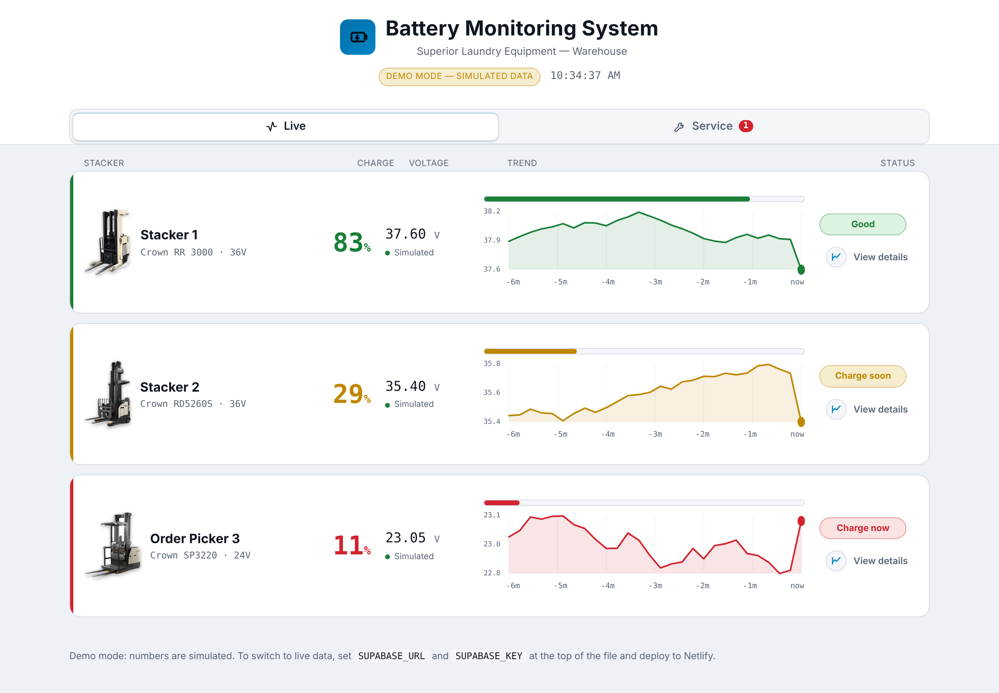

# Stacker Battery Monitoring System

Real-time battery-voltage monitoring and maintenance tracking for warehouse electric stackers (reach trucks & order pickers) at **Superior Laundry Equipment**.

> ⚡ **Live demo runs in simulated mode** — open `index.html` and the three stackers update live, no backend required.



---

## The problem

Warehouse stackers run on large traction batteries (24 V / 36 V). Operators have no way to know a battery's charge until it dies mid-shift, and maintenance is tracked on paper. The goal: a cheap, reliable way to see every battery's state at a glance and never miss a service.

## The solution

Low-cost ESP32 nodes measure each battery's voltage with 16-bit precision and stream it to a cloud dashboard that shows live state-of-charge, history, and automatic service reminders — viewable on a wall screen, phone, or desktop.

## Architecture

```
  ESP32-C3 node  (one per battery)              Supabase (cloud)            Clients
  ┌───────────────────────────┐                ┌──────────────────┐       ┌──────────────────┐
  │ voltage divider 150k/10k  │                │ Postgres + REST  │       │ Web dashboard    │
  │ ADS1115  16-bit I²C ADC   │  ──HTTPS POST─▶ │ Row Level Sec.   │ ──▶   │ (Netlify)        │
  │ XL7015 buck  (8–80V→5V)   │                │ realtime / poll  │       │ phone·desk·wall  │
  └───────────────────────────┘                └──────────────────┘       └──────────────────┘
```

## Features

- **Live voltage + state-of-charge** per battery, color-coded: Good / Charge soon / Charge now
- **Per-chemistry SoC curves** (lead-acid & LiFePO4) based on resting voltage
- **History charts** — 24 h / 48 h / 72 h with hourly divisions
- **Maintenance log** with automatic next-service reminders (quarterly), plus one-time-service support; add / edit / delete records
- **Responsive** — 10" wall display, phone, or desktop; dark & light themes

## Hardware design

- **Voltage divider** (150 kΩ / 10 kΩ, 1 %) scales 24–48 V down to the ADS1115's ±4.096 V range, with headroom for lead-acid equalization charging (~48 V worst case)
- **Wide-input buck** (XL7015, 8–80 V → 5 V) powers the node straight from the battery
- **Protection & signal integrity** — inline fuse at the battery tap, RC low-pass filter (0.1 µF) on the ADC input, optional 3.6 V Zener clamp
- **Resting-voltage SoC** with awareness of load-sag while the motor runs

## Tech stack

| Layer | Tools |
|-------|-------|
| Embedded | ESP32-C3 (RISC-V), ADS1115, Arduino / C++ |
| Backend | Supabase — Postgres, PostgREST, Row Level Security, publishable keys |
| Frontend | Vanilla HTML / CSS / JS (no framework), hand-drawn SVG charts |
| Hosting | Netlify (static), Supabase (cloud DB) |

## Repository contents

- `index.html` — the full dashboard (single self-contained file, demo mode)
- `supabase_schema.sql` — database tables + Row Level Security policies

## What this demonstrates

End-to-end IoT: analog hardware design, embedded firmware, a secure cloud backend, and a production-quality frontend — designed, built, and deployed as one system.

---

Built by **Nodari Latsabidze** — Electronics & Hardware Design Engineer, Brooklyn NY.
